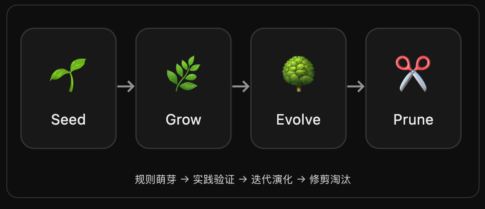

# RuleGarden

*RuleGarden — A self-evolving rule system that grows from experience.*

一套通用的、能够自我生长和持续演化的规则体系，给 AI 编程助手（Cursor、Claude Code、Codex）用。

**规则不是被静态维护的，而是在实践、反馈、纠错中不断生长的。**

把规则当作可以播种、生长、修剪、淘汰的知识。所以它叫 Garden：强调的是演化（Evolution）、生长（Growth）、涌现（Emergence），而不是同步或保管。



**自生长不等于无限累积**。一套真正有价值的自生长规则体系，还应该能够识别错误规则、解决冲突、主动淘汰过时规则。

适合这样的你：用 AI 写代码，发现规则文件越写越长、很快过时，或者每开一个新项目都要重写一遍。

## 怎么开始

```bash
git clone https://github.com/Canace22/RuleGarden.git
bash RuleGarden/scripts/garden.sh init /path/to/your-project
```

然后打开项目里的 `AGENTS.md`，填上项目概述、常用命令和常见入口，就可以开始用了。基本约束可以先留空，让它自己长出来。

项目已经有 `AGENTS.md` 也能用：`init` 不会覆盖任何已有文件，你只需要把 [`template/AGENTS.md`](template/AGENTS.md) 里“Skills”一节合并进自己的文件。

## 它往项目里放了什么

| 文件 | 作用 |
|---|---|
| `AGENTS.md` | 规则主干。每次对话都会全量加载，所以要保持短 |
| `CLAUDE.md` | 一行指针，让 Claude Code 也读到 `AGENTS.md` |
| `.agents/skills/` | 按需加载的工作流（skill），自带 5 个共享 skill 和一份索引 |
| `.claude/skills` | 指向 `.agents/skills` 的符号链接，让三个工具读同一份 |

## 规则怎么长

| 阶段 | 发生什么 | 谁决定 |
|---|---|---|
| Seed 萌芽 | AI 做完一个有实质内容的任务，把值得记下的做法或坑写进项目 skill | AI 直接写，写完用一句话告诉你 |
| Grow 验证 | 同一条经验在多个模块反复出现，升为 `AGENTS.md` 的约定 | AI 提议，你确认 |
| Evolve 演化 | 违反了会出实际问题的，升为基本约束；换个项目也成立的，回流到这个仓库的共享 skill | AI 提议，你确认 |
| Prune 修剪 | 规则和代码现状不符、引用失效、互相矛盾，或被你推翻两次以上，就修改或删除 | 项目 skill 由 AI 直接改，其余由 AI 提议 |

新经验先落在 skill 里，是因为 skill 按需加载，多长一些成本很低；`AGENTS.md` 每次对话都要读，只留经过验证的少数几条。

这套机制写在 [`skills/skill-harvest`](skills/skill-harvest/SKILL.md) 里。

## 自带的 5 个共享 skill

| Skill | 什么时候用 |
|---|---|
| [`skill-harvest`](skills/skill-harvest/SKILL.md) | 做完任务后判断要不要沉淀成 skill；发现规则过时或矛盾时提议修剪 |
| [`safe-change-workflow`](skills/safe-change-workflow/SKILL.md) | 改代码前后：定向搜索 → 看懂相关代码 → 最小化改动 → 列 3-5 条 case |
| [`pre-commit-secrets`](skills/pre-commit-secrets/SKILL.md) | 提交前扫描密钥、token、`.env`、私钥 |
| [`mermaid-verify`](skills/mermaid-verify/SKILL.md) | 画完 Mermaid 图后自检能否渲染、暗色下是否清晰 |
| [`human-readable-docs`](skills/human-readable-docs/SKILL.md) | 写 README 等给人看的文档时，切到“第一次来的人”的视角 |

只有 `skill-harvest` 是自生长机制必需的，其余四个不想要可以从项目里删掉。

## 多个项目一起用

共享 skill 更新后，在每个项目里同步一次：

```bash
cd RuleGarden && git pull
bash scripts/garden.sh sync /path/to/your-project
```

同步的规则很简单：

- 只覆盖共享 skill，`AGENTS.md` 和项目自己的 skill 永远不动。
- 只更新项目里已有的共享 skill，你删掉的不会被加回来。
- 同步会直接覆盖，所以不要在项目里改共享 skill。要定制就另写一个项目 skill；通用的改进提交回这个仓库。

## 需要知道的

- 模板里带着作者的默认偏好，比如“改完列 3-5 条 case”“默认不主动跑测试”。不合适的话，fork 这个仓库后改 `template/` 和对应的 skill。
- 规则只是写给 AI 的要求，它是否每次都照做取决于模型。发现它该沉淀时没提，可以直接说“沉淀一下”。
- 脚本需要 bash，支持 macOS、Linux 和 WSL。
- 内容目前只有中文。
