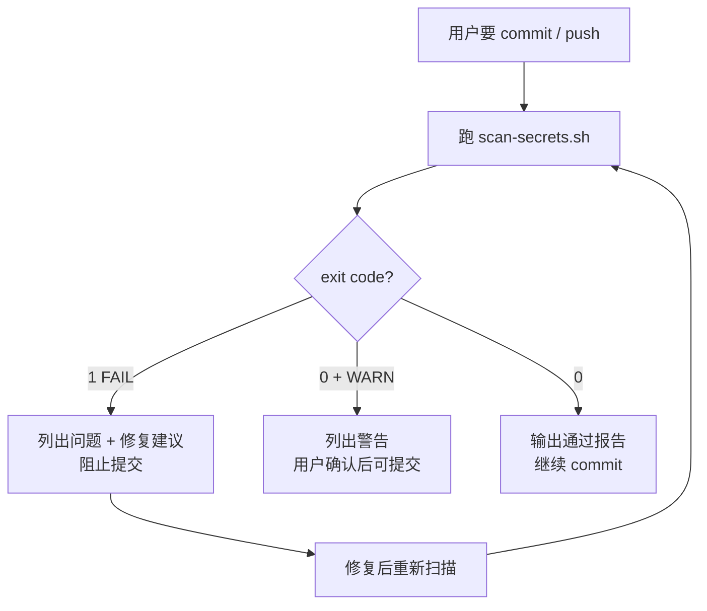

# 提交前敏感信息检查

每次 git commit / push 前，先确认变更里没有密钥、凭证或不该进仓库的文件。漏检一次就可能把 token 永久写进历史。

## 为什么这么做

- 密钥进 git 历史后，即使后续删除文件也仍可从历史恢复。
- 调试时临时写进代码、测试 fixture、日志里的真实 token 最容易被顺手提交。
- 自动化扫描 + 人工确认，比凭感觉 commit 可靠。

## 流程



## 步骤

### 1. 确定扫描范围

| 场景 | 命令 |
|------|------|
| 即将 commit（默认） | `bash .agents/skills/pre-commit-secrets/scripts/scan-secrets.sh --staged` |
| 工作区全部变更 | `bash .agents/skills/pre-commit-secrets/scripts/scan-secrets.sh --working` |
| 全仓库审计 | `bash .agents/skills/pre-commit-secrets/scripts/scan-secrets.sh --all` |

### 2. 执行脚本并解读结果

- **FAIL（exit 1）**：必须修复后才能提交。
- **WARN**：可能是误报，逐条人工确认；确认安全才可提交。
- **OK**：可继续 commit。

### 3. 补充人工检查（脚本覆盖不到的）

- `git diff --cached` 目视扫一遍：有没有调试用的真实 token、个人路径、内网 URL。
- 新增 JSON / 测试 fixture 里是否夹带了用户数据。
- 构建产物和依赖目录是否在 `.gitignore` 里且未 staged。

### 4. 输出报告模板

```markdown
## 敏感信息扫描报告

**范围**: staged / working / all
**结果**: ✅ 通过 | ⚠️ 有警告 | ❌ 阻断

### 发现项
- （无则写「未发现」）

### 建议
- （FAIL 时写具体修复步骤）
```

## 常见误报（不要当 FAIL）

- 解析器 / 词法分析语境下的 `token`
- `design-tokens`、`js-tokens` 这类文件名或包名
- 表单里的 `type="password"`、`placeholder="..."`（UI 占位，非真实密钥）
- GitHub Actions 的 `id-token: write`（OIDC 权限，非 secret）

项目有自己的敏感面（某个特定服务的 token、某类不该提交的数据文件）时，另写一个项目 skill 记录，不要直接改这份共享 skill。

## 泄露后的处理

若密钥**已经 commit 但未 push**：

1. 从变更中移除敏感内容
2. 用新 commit 修复（不要 amend 已 push 的 commit）
3. **立即轮换/作废**已泄露的密钥

若**已经 push**：

1. 轮换密钥（优先）
2. 再考虑 `git filter-repo` / BFG 清理历史（改写历史前先和用户确认）

## 与 commit 流程的关系

用户要求 commit 时：

1. **先** `git add` 本次要提交的文件，跑 `--staged` 扫描
2. 通过后再 `git commit`；有 WARN 时把报告给用户看，确认后再提交

## 完成标准

- 扫描脚本已执行，exit code 和发现项已报告
- FAIL 项已给出修复建议，未在 FAIL 状态下提交
