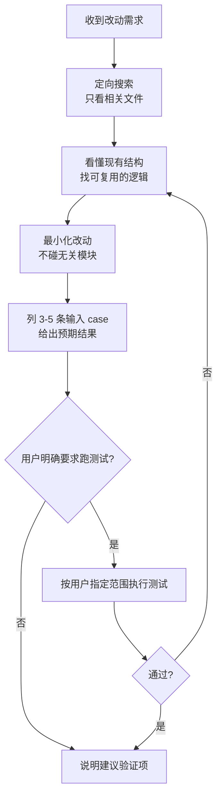

# 安全改动流程

这个 skill 把"改动前想清楚、改动后验证到位"固化成可执行的步骤。目的是避免两类常见问题：改之前没看懂现有代码导致改错地方，改之后没验证导致引入回归。

## 为什么这么做

代码改动的风险大多来自两个盲区：一是没看全相关代码就动手，把本来能复用的逻辑重写了一遍，或者破坏了别处依赖；二是改完凭感觉觉得"应该对"，没有真正验证边界情况。这个流程用最小成本堵住这两个盲区。

## 执行步骤



### 1. 定向搜索，只看相关文件

先用搜索工具定位到真正相关的文件，不要一上来全量读。明确忽略：lockfile、构建产物目录、依赖目录、大型生成文件。

项目 `AGENTS.md` 里有“常见入口”表的，先从那里找起点。

### 2. 看懂现有结构再动手

读完相关文件后，先回答自己三个问题：现有有没有能复用的函数？这块逻辑被谁依赖？改了会不会影响别的模块？想不清楚就继续读，不要偷懒。

### 3. 最小化改动

只改完成任务所需的最少代码。不顺手重构无关代码，不修改其他模块。遵循项目 `AGENTS.md` 的基本约束和约定。

### 4. 列 3-5 条 case 并给出预期

改完后，假定 3-5 条有代表性的输入，逐条写出预期结果。从正常情况、空输入、边界值、特殊字符、嵌套/组合情况、超长输入里挑和本次改动最相关的几类。这一步是用具体例子逼自己检查逻辑漏洞，不是走过场。

格式示例：

```
| # | 输入 | 预期输出 |
|---|------|---------|
| 1 | 正常输入 | ... |
| 2 | 空字符串 | 空/默认值 |
| 3 | 边界值 | ... |
```

### 5. 测试执行边界

默认只列建议验证项，不主动执行测试命令。用户明确要求"跑测试""帮我验证""跑单测"时，优先跑最小范围的单测或用户指定的命令。

不要主动跑 E2E / 浏览器自动化测试；只有用户明确点名，或正在处理必须靠浏览器复现的视觉/交互问题并得到用户同意时，才执行。

**跑完必须清理临时产物。** 一旦执行过测试，完成后用 `git status` 检查工作区，删掉测试留下的临时文件，不要让它们污染 git 状态。

## 完成标准

- 只改了必要的代码，没碰无关模块
- 给出了 3-5 条 case 及预期，或说明建议验证项
- 改动符合项目 `AGENTS.md` 的约束和约定
