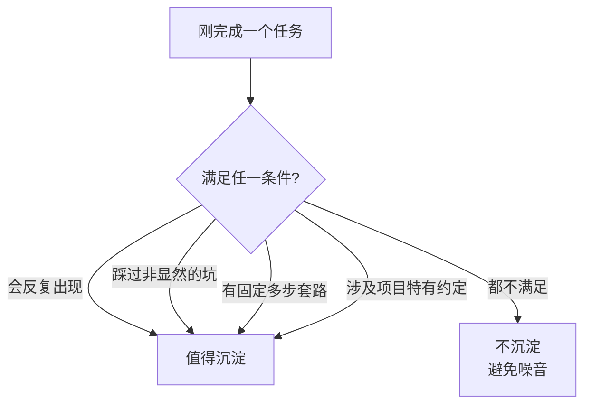

# Skill 沉淀器

规则不是一次写定的，而是跟着项目一起长的。这个 skill 是让它持续运转的引擎：每完成一段有套路的工作，停下来判断它值不值得固化，值得就按统一规范生成；同时留意已有规则有没有过时，过时就修剪。

## 什么时候该沉淀（判断标准）

不是所有任务都值得做成 skill。满足下面任意一条，才考虑沉淀：



- **会反复出现**：这类任务以后还会做很多次（如"又接入一个第三方接口"）。
- **踩过非显然的坑**：过程中发现了不看代码就想不到的陷阱（如"某个平台只认内联样式"）。
- **有固定多步套路**：步骤明确且容易漏掉某步（如"改完数据结构要同步迁移脚本和索引"）。
- **涉及项目特有约定**：和这个项目的结构强绑定（如"全局状态只走某一个 store"）。

反过来，**不要沉淀**：一次性的任务、纯通用常识、`AGENTS.md` 已经写清楚的静态规范（除非要把它变成可执行流程）。沉淀过多会稀释信噪比，让真正有用的 skill 不容易被触发。

## 沉淀前先查重

生成新 skill 前，先扫一遍 `.agents/skills/` 看有没有已存在的。如果只是已有 skill 的补充，**优先改那个 skill** 而不是新建——避免职责重叠的 skill 互相打架。

## 修剪：规则也会过期

规则是在某个阶段、为某个具体问题写下的，项目往前走了它就可能不再成立。只长不剪，规则会越积越多，真正有用的反而被淹没。干活时遇到下面任一信号，就提出来：

- **和代码现状不符**：规则说的和仓库里实际的不一样（如规则写"全是 JS"，实际已有 TS 包）。
- **引用失效**：规则里的文件、命令、模块已经不存在或改名。
- **互相矛盾**：两处规则对同一件事说法不同（如一处要 10 条 case，一处要 3-5 条）。
- **反复被推翻**：同一条规则被用户否掉或要求破例两次以上。

处理方式看规则在哪：

- **项目 skill 里的**：直接改或删，改完一句话告知。
- **`AGENTS.md` 里的**：只提议，说明哪条、为什么过时、建议怎么改，用户确认后再动。
- **共享 skill 里的**（索引里标为共享、从规则仓库同步来的）：不在项目里直接改，同步时会被覆盖；提议把修改提交回规则仓库。

## 经验落在哪：一级一级往上走

新经验别一上来就写进 `AGENTS.md`。它每次对话都会全量加载，要保持短；skill 按需加载，生长成本低。

1. 先记进对应的项目 skill。
2. 跨模块反复出现，再提议升为 `AGENTS.md` 的约定。
3. 违反了会出实际问题，才提议升为基本约束。
4. 换个项目也成立、不依赖当前项目的经验，提议回流到共享规则仓库。
5. 过时就降级或删除。

第 2-4 步都只提议，由用户确认。

## 生成步骤

1. **提炼意图**：从刚完成的任务里抽出——这个 skill 让 agent 能做什么、什么情况下该触发、产出是什么。优先从对话历史里找答案（用了哪些工具、步骤顺序、用户做过哪些纠正）。
2. **建目录**：`.agents/skills/<kebab-case-name>/SKILL.md`。名字用小写连字符，能见名知意。
3. **写 frontmatter**：
   - `name`：和目录名一致。
   - `description`：**最关键**，决定触发准确率。要同时写清"做什么"和"什么时候用"，并列出会触发的用户说法。略微"主动"一点，因为 skill 容易该触发时不触发。所有"何时用"的信息都放这里，不要放正文。控制在 250 字以内，太长有的工具会直接丢掉描述；文件路径这类细节放正文。
4. **写正文**：用祈使句。**解释为什么**这么做（说人话，别堆术语），而不是干巴巴列 MUST。复杂流程配一张 Mermaid 图（暗黑主题清晰、语法可渲染——参考 `mermaid-verify` skill）。给出步骤、关键约束、验证方法。
5. **带上项目惯例**：涉及改代码的 skill，正文里沿用项目 `AGENTS.md`“验证与提交”一节的约定（如"列 3-5 条 case""默认不主动跑测试，用户要求时才跑"）。
6. **更新索引**：在 `.agents/skills/README.md` 的“项目 skill”表里登记，并用一句话告诉用户沉淀了什么、为什么值得。

## SKILL.md 模板

```markdown
---
name: 技能名-kebab-case
description: 做什么 + 什么时候触发（列出用户会说的话）。略主动。
---

# 技能名

一句话说清这个 skill 解决什么问题。

## 为什么这么做
解释背后的原因（说人话）。

## 步骤
（复杂流程配 Mermaid 图，自检可渲染、暗色清晰）

## 关键约束 / 易踩的坑

## 验证
（改代码类：沿用项目 AGENTS.md 的验证约定）

## 完成标准
```

## 写完自检

- frontmatter 的 `name` 和目录名一致，`description` 写清了触发场景且不超长
- 正文解释了"为什么"，不是纯命令堆砌
- 有 Mermaid 图的，语法可渲染、暗色清晰（见 `mermaid-verify`）
- 没和已有 skill 职责重叠
- 索引已更新
- 简洁，不过度设计

## 完成标准

判断结论明确（沉淀 / 不沉淀 / 修剪，给理由）；决定沉淀时，产出一个符合上述规范、放在 `.agents/skills/` 下的 SKILL.md；发现过时规则时，项目 skill 里的已改好并告知，`AGENTS.md` 和共享 skill 里的已向用户提出。
